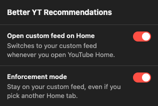

# Better YT Recommendations

Remove youtube distractions by giving you control over your feed.

Set up **Your custom feed** in YouTube with the topics you want to see. This
extension opens that tab whenever you visit Home, including when you click the
YouTube logo. You can still switch to other tabs whenever you want, unless you
turn on enforcement mode.

You'll need **Your custom feed** already available on your YouTube account, on your
computer.

## Settings

Click the extension's icon in the Chrome toolbar to change these. Open YouTube tabs
pick up changes right away.

- **Open custom feed on Home** (on by default): switches to Your custom feed when
  Home opens. Turn it off to pause the extension.
- **Enforcement mode** (off by default): keeps you on Your custom feed. Clicking
  another Home tab, like Podcasts or All, does nothing, and if YouTube switches tabs
  on its own, the extension switches back.



## Languages

The extension recognizes the custom feed tab when YouTube is in any of the ten most
spoken languages: English, Mandarin Chinese (Simplified and Traditional), Hindi,
Spanish, Arabic, French, Bengali, Portuguese, Russian, and Indonesian. The settings
popup is translated into the same languages.

YouTube first launched the custom feed in English, so tab names in other languages
are based on YouTube's Help Center. If the extension doesn't find the tab in your
language, add the name YouTube shows to `src/labels.js` and open an issue.

## Setup

1. Click **Code → Download ZIP** on this page and unzip the download.
2. Open `chrome://extensions` in Chrome.
3. Turn on **Developer mode** in the top-right corner.
4. Click **Load unpacked** and choose the unzipped folder containing `manifest.json`.
5. Refresh YouTube. Your custom feed will open automatically.

Keep the folder on your computer. After updating the files, click the extension's
reload button at `chrome://extensions`, then refresh YouTube.

## Privacy

The extension runs only on YouTube. It doesn't track you or collect your data. It
saves your two settings in Chrome, which syncs them across your computers if you use
Chrome sync.

## Development

No build step. Reload the extension at `chrome://extensions` after editing, then
refresh YouTube.

- `src/content.js` selects the tab on YouTube.
- `src/labels.js` lists the tab's name in each language.
- `src/settings.js` stores the settings for the content script and the popup.
- `src/popup.html`, `src/popup.css` and `src/popup.js` are the settings popup.
- `_locales/` has the popup's translations.

To run the checks, install Node.js 24 or later and pnpm 11, then run:

```sh
pnpm install
pnpm check
```

[MIT license](LICENSE)
